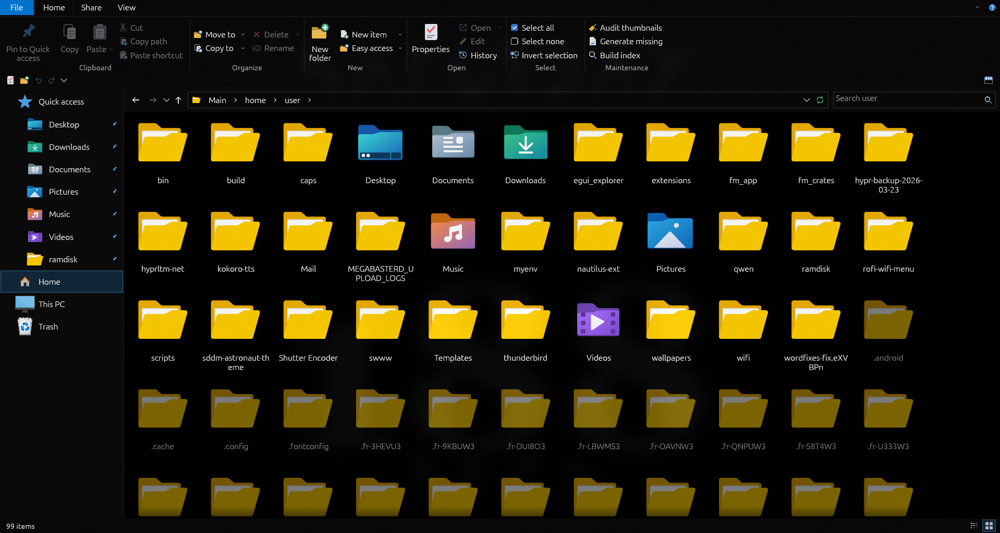

<h1>Windowstyle File Manager</h1>

<strong>The Windows 10 Explorer experience, native on Linux.</strong>

A fast, lightweight file manager with the ribbon, breadcrumb bar and layout you already know, 
built for Linux desktops and careful with your disk.

<a href="#features">Features</a> &nbsp;·&nbsp;
<a href="#download-and-run">Download</a> &nbsp;·&nbsp;
<a href="#keyboard-shortcuts">Shortcuts</a> &nbsp;·&nbsp;
<a href="#configuration">Configuration</a>

---

## Overview

If you moved from Windows to Linux and miss File Explorer, Windowstyle is built for you. It recreates the Windows 10 ribbon-style Explorer: the same tabs, the same commands, the same keyboard shortcuts and the same way of working.

It runs natively on Linux, shares your desktop's own Trash, and is designed to be gentle on your SSD. There is no background index database and very few disk writes.

<table>
<tr>
<td width="33%" valign="top">

**Familiar** 
Ribbon tabs, breadcrumb navigation, eight view modes and the shortcuts you already know.

</td>
<td width="33%" valign="top">

**Native** 
A single executable for X11 and Wayland. Integrates with the standard Linux Trash.

</td>
<td width="33%" valign="top">

**Efficient** 
Listings and search live in memory. State is saved as one small text file, and only when something changed.

</td>
</tr>
</table>

---

## Features

### Ribbon Interface

| | |
|---|---|
| **Tabs** | File, Home, Share and View, with commands grouped as in Windows 10 |
| **Contextual tabs** | Appear for drives, pictures, applications, compressed files and media |
| **Display modes** | Expanded, tabs only, or fully hidden with auto-show |
| **Quick Access Toolbar** | Customizable, placed above or below the ribbon |
| **Key tips** | Press Alt to navigate the ribbon entirely from the keyboard |
| **Adaptive layout** | Ribbon groups collapse into drop-downs when the window narrows |
| **Title bar** | Optional custom title bar with its own minimize, maximize and close buttons |

### Navigation

- **Breadcrumb address bar.** Click any segment, open a sub-folder drop-down from its arrow, or click to type a path.
- **Back, Forward and Up**, with a recent-locations history.
- **Navigation pane** with Quick Access, your standard folders (Desktop, Downloads, Documents, Pictures and more) and This PC.
- **Pin any folder** to Quick Access.
- **Lazy folder tree.** Branches load as you open them, so large drives stay responsive.

### Views

Eight layouts are available: **Extra large icons, Large icons, Medium icons, Small icons, List, Details, Tiles** and **Content**.

- Resizable, sortable columns with a column chooser
- Grouping by name, date modified, type or size, with collapsible group headers
- Each folder can remember its own view, sort order and grouping
- Toggles for hidden items, file name extensions and item check boxes
- Optional Preview pane and Details pane

### Thumbnails

- Real thumbnails for **images and videos**, generated only for items currently on screen
- Video thumbnails use `ffmpeg` when it is installed
- Disk cache capped at roughly 2 GiB, with the oldest entries removed first
- **Audit thumbnails** produces a read-only report of missing, stale, corrupt, unsupported or unreadable entries
- **Generate missing thumbnails** is a separate, explicit action

### File Operations

- Copy, Cut, Paste, Move to, Copy to, Rename and Delete
- New folder and New text file
- Paste shortcut and New shortcut (symbolic links)
- **Name conflict handling.** Choose to replace or keep both.
- **Undo and Redo** for file operations
- **Drag and drop** onto folders and navigation pane entries
- Inline rename with the name pre-selected, type-ahead find and rubber-band selection
- Select all, select none and invert selection
- Copy path, name, folder path or file URL to the clipboard
- Files copied in the manager can be pasted into other applications

### Trash

Windowstyle follows the freedesktop.org Trash specification, so its trash is shared with GNOME, KDE, Thunar and other compliant file managers.

- Restore items, empty the trash, or delete permanently with confirmation
- Works across drives, using a trash folder on each filesystem
- Restoring never overwrites an existing file

### Archives

<table>
<tr>
<th align="left" width="160">Compress to</th>
<td>ZIP &nbsp;·&nbsp; TAR &nbsp;·&nbsp; TAR.GZ &nbsp;·&nbsp; TAR.XZ &nbsp;·&nbsp; TAR.BZ2 &nbsp;·&nbsp; TAR.ZST &nbsp;·&nbsp; 7Z</td>
</tr>
<tr>
<th align="left">Extract</th>
<td>To a folder, or directly into the current folder with Extract here</td>
</tr>
<tr>
<th align="left">Options</th>
<td>Adjustable compression level and password protection for ZIP and 7Z (AES-256 ZIP requires 7-Zip)</td>
</tr>
<tr>
<th align="left">Also supports</th>
<td>Password-protected archives with a password prompt, single-file GZ, XZ, BZ2 and ZST files, and RAR archives when <code>unrar</code> is installed</td>
</tr>
</table>

### Search

- Live **filter-as-you-type** in the current folder
- Search across the current folder and all of its subfolders
- **Fast search** through the system's `plocate` database, falling back to `find` when plocate is missing or finds nothing (tmpfs folders are walked directly). Results list folders first, shallow levels first; caches (`.cache`, `node_modules`, `.git`, ...) are skipped, and bulky application data (`.var`, browser profiles, ...) is skipped unless "Search app data" is on. `.config` and `.local` stay searchable. Search runs as you type.

### Properties

A Properties window shows size, size on disk, contents, timestamps and permissions. Folder sizes are calculated in the background and can be cancelled.

### Appearance

- Light and dark mode. Only the interface changes; images and videos are never tinted.
- More than 100 built-in vector icons that stay sharp at any size
- Replaceable icons: substitute any built-in icon with your own PNG
- Adjustable interface zoom
- Window size and position, columns, view and ribbon layout are remembered between sessions

### Everyday Tools

- **Open terminal here**, using your preferred terminal emulator
- **Edit** in your configured editor, or a common graphical editor
- **E-mail** the selected files with a configurable mail command
- **Open** files with your system's default application
- Frequent places and recent history in the File menu

---

## Designed to Be Light

| Principle | What it means |
|---|---|
| **No own search index** | Search uses the system `plocate` database; directory listings live in RAM. |
| **Learns how you work** | Pins, frequently visited folders and your usual next folder are tracked in memory. |
| **Minimal writes** | State is saved to one small text file at shutdown, or after enough change and at least 30 minutes. Nothing is written if nothing changed. |
| **Safe shutdown** | State is saved on exit, before suspend or shutdown, and when the app receives a termination signal. |
| **Live updates** | The window refreshes when files change on disk. Rapid bursts of changes are combined to avoid flicker. |
| **On-demand thumbnails** | Created only for visible items. Inexpensive thumbnails are never saved to disk. |

---

## Keyboard Shortcuts

Familiar Explorer shortcuts work as you would expect. A selection:

| Action | Shortcut |
|---|---|
| Select all | `Ctrl` `A` |
| Copy / Cut / Paste | `Ctrl` `C` / `Ctrl` `X` / `Ctrl` `V` |
| Undo / Redo | `Ctrl` `Z` / `Ctrl` `Y` |
| Rename | `F2` |
| Refresh | `F5` |
| Delete / Delete permanently | `Del` / `Shift` `Del` |
| Properties | `Alt` `Enter` |
| Back / Forward / Up | `Alt` `Left` / `Alt` `Right` / `Alt` `Up` |
| Edit the address | `Ctrl` `L`, `Alt` `D` or `F4` |
| Search | `Ctrl` `E`, `Ctrl` `F` or `F3` |
| New folder | `Ctrl` `Shift` `N` |
| New text file | `Ctrl` `Shift` `T` |
| Copy path | `Ctrl` `Shift` `C` |
| Hidden items | `Ctrl` `H` |
| File name extensions | `Ctrl` `Shift` `H` |
| Switch view | `Ctrl` `Shift` `1` to `8` |
| Navigation pane | `Alt` `N` |
| Preview pane | `Alt` `P` |
| Minimize or expand the ribbon | `Ctrl` `F1` |
| Open terminal here | `Ctrl` `Alt` `T` |

The complete list is available inside the app.

---

## Download and Run

1. Download **`file-manager-linux-x86_64.tar.gz`** from the [Releases](../../releases) page.
2. Extract the archive. It contains the `file-manager` executable and this README.
3. Run the `file-manager` executable. No installer is required.

### Requirements

- 64-bit (x86-64) Linux desktop running X11 or Wayland
- A working OpenGL driver

### Optional tools

Windowstyle works on its own. These tools enable additional features:

| Tool | Enables |
|---|---|
| `ffmpeg` | Video thumbnails |
| `7z`, `7zz` or `7za` | 7Z archives and AES-256 encrypted ZIP files |
| `zip` and `unzip` | ZIP creation and extraction |
| `unrar` | Extracting RAR archives |
| `tar` | TAR-based archives |
| A mail client | The E-mail command |
| `dbus-monitor` or `gdbus`, and `systemd-inhibit` | Saving state just before suspend or shutdown on systemd systems |

---

## Configuration

| Item | Location |
|---|---|
| Settings | `~/.config/file-manager/settings.toml` |
| Learned behavior | `~/.local/state/file-manager/behavior.txt` |
| Thumbnail cache | `~/.cache/file-manager/` |
| Custom icons | `~/.config/file-manager/icons/` |

Standard XDG locations are respected if you have customized them.

<strong>Using your own icons</strong>

 

On first launch, Windowstyle creates a placeholder for every icon in the icons folder, with names such as `Folder.png.inactive`.

To replace an icon, place a valid PNG in that file and rename it to remove the `.inactive` ending, for example `Folder.png`. Restart the application to load it. If a custom file is not a valid PNG, the built-in icon is used instead.

<strong>Preferences and options</strong>

 

- Dark mode and thumbnails can be toggled from the View menu and Preferences.
- The e-mail command can be set in the settings file.
- Set the `FM_WRITE_STATS` environment variable to `1` to print how many bytes the application writes to disk.

---

## Current Limitations

- Linux only
- English interface only
- Columns cannot yet be re-ordered by dragging
- The address bar does not auto-complete paths
- Ctrl and mouse wheel icon zoom is not available
- Long names in the navigation pane are clipped rather than scrolled
- Search covers the current folder and its subfolders: `plocate` first, then `find`, then "Not found". "Build index" opens a terminal running `sudo updatedb`.

---

## License

Released under the [MIT License](LICENSE).

 
Windowstyle File Manager. The Explorer you know, on the system you chose.

